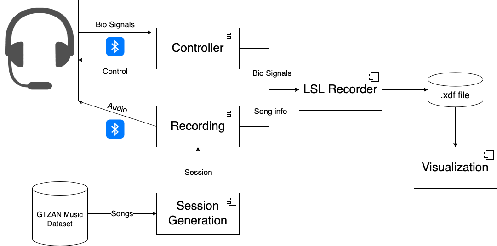

# Acquisition
This directory contains the jupyter notebooks, python scripts and MATLAB functions responsible for the acquisition of the EEG signals. This includes the generation of music sessions and the communication with the LSL system as well as signal segmentation and visualizing.

## General setup
0. Don't forget to follow the general code setup steps including setting up the virtual environment and installing the requirements, as well as the MATLAB setup if you intend to use the MATLAB functions.

1. Download the [GTZAN Dataset - Music Genre classification](https://www.kaggle.com/datasets/andradaolteanu/gtzan-dataset-music-genre-classification) on kaggle.

2. Move the GTZAN dataset to the `data` folder and rename the directory from `Data` to `gtzan`. Make sure that the `gtzan` directory contains the folder `genres_original`. The other directories inside `gtzan` can be removed. Also make sure that each genre directory contains 100 songs.

## Functionality

  

### [Session generation](session-generator.ipynb)
This notebook is responsible for generating the distinct sessions for the acquisition. The whole dataset is split in 20 distinct sessions each containing 50 songs. Each session is balanced according to their respective genre, so that each genre is represented by 5 songs. The distinct sessions are stored in an auto-generated folder in `data` called `music_sessions`. Each session directory contains the `.wav` files for each song.

### [Experiment Manager](recording.py)
This python script is responsible for managing the experiment setup and the communication with the LSL streams which handles the recording of EEG data. Depending on the provided session number, the script takes a pre-generated session by [Session generation](session-generator.ipynb) and plays the corresponding songs in a random order. While doing that, markers are pushed to the LSL stream to signalize where a "listening experience" started and where it ended, as well as which genre it was.

### [EEG Visualization](createEEGPlots.m)
This MATLAB function takes in an .xdf file generated by the LSL recorder and creates 
.fig files for each EEG channel. The logic of drawing is implemented in a helper function called [plotXDF](plotXDF.m). It is optional whether the single segments of each songs are drawn or not. Right now, the figures have to be saved manually as MATLAB file saving is a bit tricky.

### [File segmentation](session-segmentation.ipynb) DEPRECATED, USE THE [Script](segmentation.py)
This notebook's responsibility is to take care of segmenting the recorded signal data. With the help of the pushed markers and timestamps, a table is constructed with each biosignal as a column. Each entry holds an array with all the signal data of the corresponding channels. The naming convention of the columns is (apart from the genre column) `<BIOSIGNAL><CHANNEL_NAME>`. They are stored in `data/signal_data` with the Session number as a file name. Furthermore, three subdirectories are created: `numpy`, `csv` and `matlab`. The table is not only converted into a `.npy` but also in a `.mat` and `.csv` file. Depending on your purposes, you might want to use one of them. Make sure to put the raw `.xdf` files in the data folder.

### [Segmentation](segmentation.py) MOVED OUTSIDE THE ACQUISITION FOLDER
This script takes in all 20 .xdf files from each session and segments them. It segments the signal based on the single songs. They are then stored in the data folder as `.pkl`, `.mat` and `.npy` file. The script also takes in two different flag. The flag `only_eeg_segments` only stores the segments of the EEG signals, since for this thesis, we are only interested in the EEG signals and not in the other Biosignals. The second flag `filter_on` defines, whether the eeg signal data should be frequency filtered. In this specific case, a bandpass filter between 0.5Hz and 30Hz and a notch filter of 50Hz. Again, filtering is only applied on EEG signals since the other Biosignals are irrelevant for our purposes.