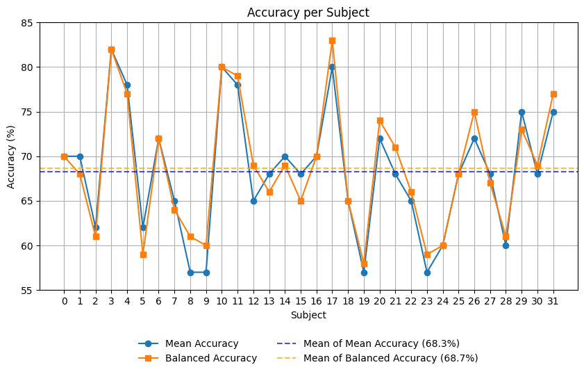
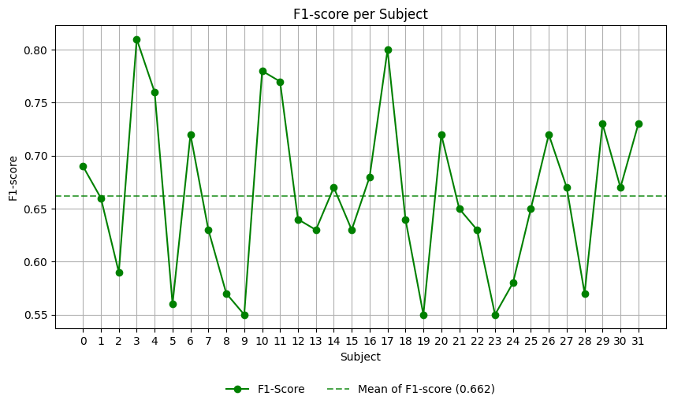
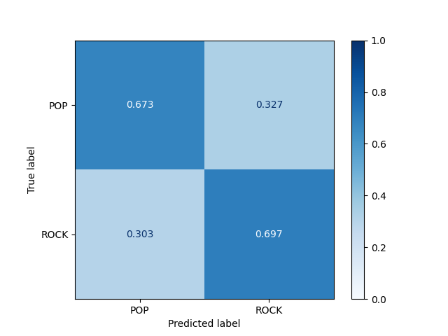
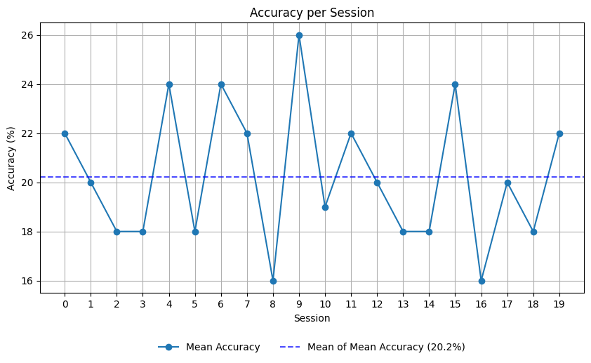
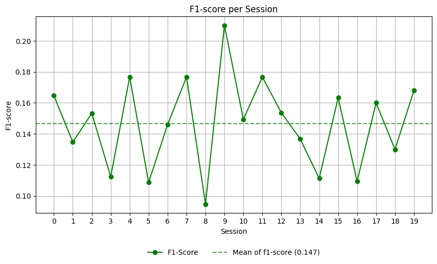
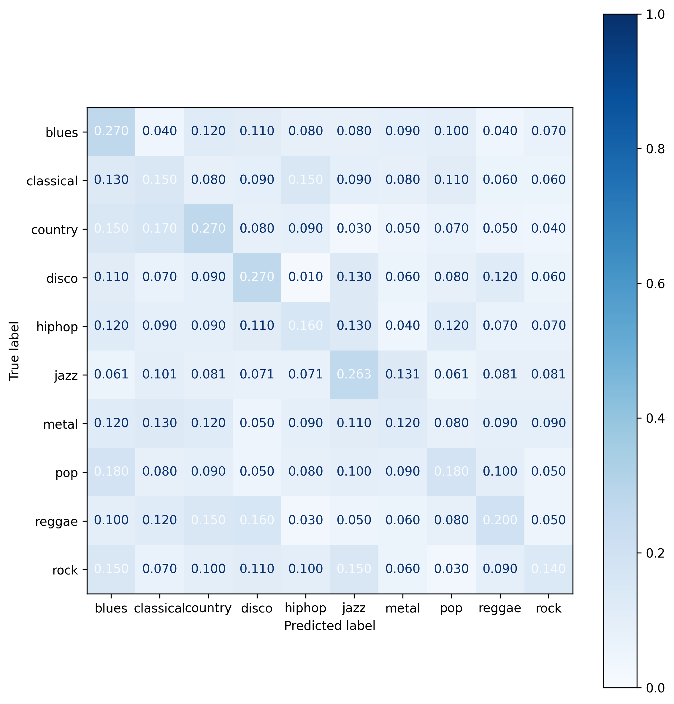

# Classification

This subsystem holds all logic and functions that are important for performing classification on the MuSiCGen dataset and the DEAP dataset. The different steps of this classification task are split between different files.

## Functionality

### Classification Pipeline

### Data loading
[data.py](data.py) and [deap_data.py](deap_data.py) are responsible for loading the MuSiCGen dataset and DEAP dataset respectively. Beforehand, all `inf` or `nan` values are filtered out.

### Feature selector
To choose the optimal subset of features, feature selectors are also implemented and can be found in [feature_selector.py](feature_selector.py). In this file you find a `FeatureSelectorFromModel`, which trains a model and uses the ranking of feature importances as a selection criteria and an `MRMRSelector`, choosing the features that share maximum relevancy and minimal redundancy. Mainly, the `MRMRSelector` is used in the case of this thesis.

### Learning environment
In [learning.py](learning.py), a `GridSearch` or `RandomizedSearch` is setup to find the optimal parameters. Furthermore, to gain more insights about the model training, [MLflow](https://mlflow.org/) is setup to log important training metrics like confusion matrices or training accuracy.

### Classification
[classification.py](classification.py) accomodates all functions concerned with performing the Hyper Parameter Tuning by combining all previously mentioned components together. By either loading the MuSiCGen dataset or the DEAP dataset, the data is split with a `StratifiedKFold` into five parts. The best estimator's accuracy and paramaters are then logged and printed to the command line.

Special cases are [deap_classification.py](deap_classification.py) and [headset_classification.py](headset_classification.py), where the hyperparameters are tuned per subject/session and the models are chosen directly including the paramater grid.

Furthermore, [svm.py](svm.py), [ranndom_forest.py](random_forest.py) and [mlp.py](mlp.py) realize the classification by initializing their respective model beforehand and perform the hyperparameter tuning.

### Evaluation
Firstly, there is the [deap_playground.ipynb](deap_playground.ipynb), in which the main diagrams are created including accuracy distribution, F1-score distribution and hyperparameter distribution. In [headset_confusion_matrix.py](headset_confusion_matrix.py) and [deap_confusion_matrix.py](deap_confusion_matrix.py), confusion matrices from the best perforiming models are generated and saved in the data directory.

## Key Results

### DEAP

### MuSiCGen

