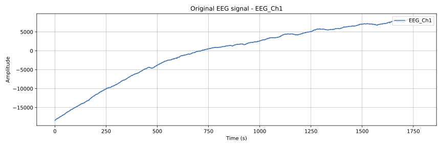
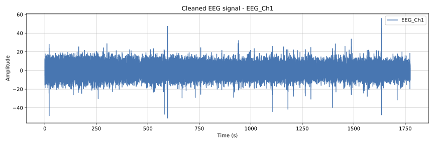

# Denoising

This folder contains all the necessary code for the denoising of EEG signal data. The main file is [denoising.py](denoising.py), in which you'll find util functions for the single steps. The steps are then implemented in [segmentation.py](../acquisition/segmentation.py). Below, you'll find an overview of those functions:

## Functionality

- `bandpass`
  - This function performs a bandpass filter on the eeg signal data. It takes the edges as a parameter, representing the lower and upper bound of the bandpass filter

- `notch_filter`
  - This function performs a notch filter on the eeg signal, being a highly selective frequency filtering

- `apply_z_normalization`
  - By taking in the data of each song in the format of (n_channels, n_signal_points), it performs z normalization (x = (x - mean) / std) on the song data

- `artifact_removal_ica`
  - This utility function takes in an entire session and removes the artifacts of the eeg signal data by applying the ICA method. Since we use an unconventional EEG system, an automatic removal depending on statistical values is applied based on percentile thresholds. This logic can be found in the `component_rejected` function, which decides whether a component is rejected or not
  
  Below, you can find a table with the rejection criteria

  | Rejection Criterion | Threshold |
  |---------------------|-----------|
  | Peak-to-Peak Amplitude (PTP) | 90 percentile of all components |
  | Kurtosis | 90 percentile of all components |
  | Skewness | 90 percentile of all components |
  | Autocorrelation (lag 1) | 90 percentile of all components |
  | Relative Delta Band Power | > 0.5 of total power |
  | Relative Beta Band Power | > 0.35 of total power |
  | Mixing Matrix Sparsity | < 3 active channels (relative threshold = 0.2) |

The [Denoising notebook](denoising_nb.ipynb), is a playground to check whether the application of artifact removal by ICA was successful or not by visualizing and comparing the data. It does not add any logic to the denoising steps and serves as an easier way of checking correctness.

## Comparision
*Unprocessed EEG signal*

*Denoised EEG signal*

